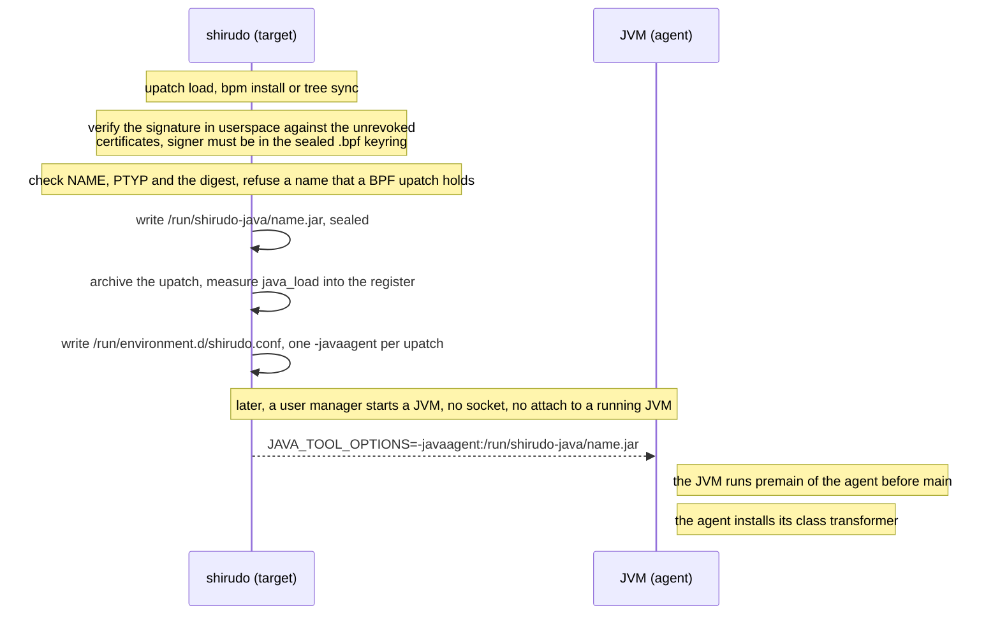
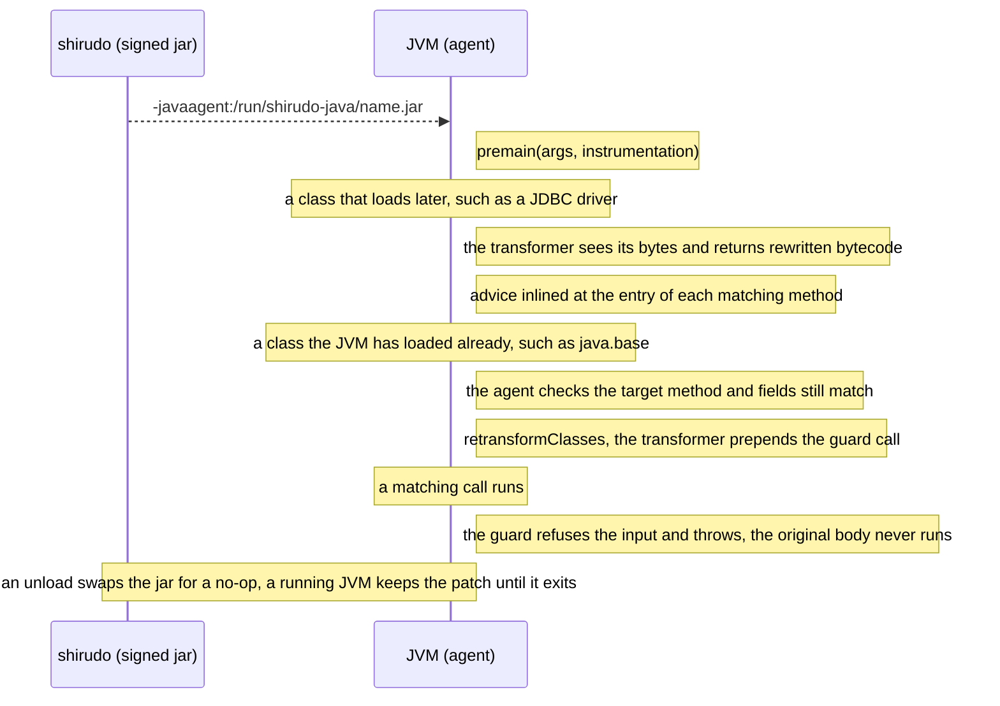

<!--
  SPDX-License-Identifier: BSD-2-Clause
  Copyright (c) 2026 Authors of shirudo
-->

# Java upatch attachment

This page explains how a Java upatch gets from the operator to the
classes of a JVM: what the operator signs, what the target verifies and
installs, how a JVM picks the agent up, and how the agent patches a
class. The commands, the options file and its limits are in
[Java agent upatches](../upatches/write/java-agents.rst), and the
container is in [the upatch format](../reference/formats/upatch-format.rst).

## Problem

A Java method has no kernel hook. A fix for a bug in a Java library or
in the JDK cannot be a BPF program attached to a function, because the
function is bytecode that the JVM interprets and compiles. What can
change it is code inside the JVM: a `java.lang.instrument` agent that
sees each class as it loads, or that retransforms one the JVM has
loaded.

## Why the obvious approaches fail

A uprobe on the compiled code fails because the JIT moves and
recompiles it, and it has no stable symbol. Injecting an agent into a
running JVM needs a socket, a trigger file or `ptrace`, and each gives
root a path into a process that shirudo does not control. An agent that
the operator copies to the host and names in a unit file is unsigned,
unmeasured and not restored at boot.

A Java upatch takes the path of every other upatch for what shirudo
controls, which is the artifact. The operator signs it, the target
verifies it, measures it into the register and restores it at boot.
What it patches is the JVMs that load the agent. The JVM loads it at
its own start, so shirudo opens no channel into a process.

## Build

`shirudo build agent.jar` signs the jar into `agent.upatch`. The
container has no loader and no `metadata`. Its signed sections are
`NAME`, `PTYP` (the payload type) and `JAVA`, the jar byte for byte.
The signature covers those sections, and `payload_sha256` is the
SHA-256 of them. An unload directive is `NAME`, `PTYP` and `UNLD`. In a
package, a Beefile upatch with `type = "java"` and a `.jar` source does
the same.

## Install and start

Figure 1 follows a Java upatch from the signed artifact to an agent in
a new JVM, with shirudo on the left and the JVM on the right.

*Figure 1. A Java upatch from the signed artifact to the agent in a new
JVM.*

The target checks the signature with OpenSSL, because the kernel never
sees a Java payload. It then requires the signer to be a key that the
sealed `.bpf` keyring holds, the same trust anchor as for a BPF loader.
A Java and a BPF upatch share one name space, and a load is refused as
`already_loaded` when either kind holds the name.

The jar and its options file are written from the bytes that were
verified. The seal keeps the jar as signed, so no task without runtime
authority can write, rename or remove it. At boot `init` verifies each
archived Java upatch that the eventlog records as loaded, writes its jar
and the options again, and `/run` carries them across switch-root.

An unload measures `java_unload`, replaces the jar with one whose agent
does nothing, removes the archive and rewrites the options without the
agent. The placeholder stays because a JVM that is given a missing
`-javaagent` jar does not start, and a user manager that started before
the unload still names it.

## How the class patch gets in

The patch is a change to a class that the agent makes through the
`Instrumentation` handle it receives in `premain`. Two upatches of the
tree show the two ways a class is reached.

A class that loads after the agent starts is rewritten as it loads. The
agent registers a `ClassFileTransformer` that sees the bytes of each
class on their way in and returns different bytecode for the ones that
match. `java-sql-inj` does this with Byte Buddy: every concrete
`java.sql.Statement` implementation gets an advice at the entry of each
`execute*(String)` method. It throws `SecurityException` on an SQL
string with a tautology or a quote before a comment, so the statement
never reaches the database.

A class that the JVM has already loaded is retransformed. The agent adds
a transformer that can retransform and calls
`Instrumentation.retransformClasses`. `java-base64` does this to
`java.util.Base64$Decoder`, which the JVM loads before any agent runs.
It prepends a call to the method `decode0`, which checks the input
shape that CVE-2026-114938 depends on and throws
`IllegalArgumentException` before the native decoder writes out of
bounds. The class the call reaches, `GuardCheck`, rides in a nested jar
that the agent appends to the bootstrap class loader, because the
`java.base` code that calls it cannot see the application class path.

Figure 2 follows both ways.

*Figure 2. How a Java upatch patches a class, as it loads and after it
has loaded.*

`java-base64` checks what it patches before it changes it. It throws
from `premain` when the signature of `decode0` or a field of the decoder
differs from the one it was written for. A patch for one JDK release is a
mitigation in front of the fix, and the fixed JDK is the durable one.

## What a Java upatch does not do

An agent does what Java code in the JVM can do. It is a mitigation
inside the application, not a boundary the kernel enforces. Root, or
the user who starts the JVM, can start one without the agent, and a
JVM that no user manager starts does not read the options file. A BPF
upatch is the tool for a policy that root must not be able to step
around. [Java agent upatches](../upatches/write/java-agents.rst) lists
what reaches a JVM and what does not.

An agent cannot report to a BPF upatch either. The BPF LSM refuses
`BPF_OBJ_GET` and `BPF_PROG_TEST_RUN` to every task but shirudo, so the
telemetry of an agent goes through the JVM's own logging. A JVM that
shirudo does not start, such as one in a container, takes the same jar
by `java -jar java-base64.jar <pid>`, an attach that shirudo neither
measures nor restores.

## Related

- [Java agent upatches](../upatches/write/java-agents.rst) for the
  commands, the options file and what reaches a JVM
- [The upatch format](../reference/formats/upatch-format.rst) for the
  Java payload and its signed sections
- [Signed loader path](signed-loader.rst) for the path a BPF upatch takes
- [Seal labels and task marks](seal.rst) for the labels that protect the jar
